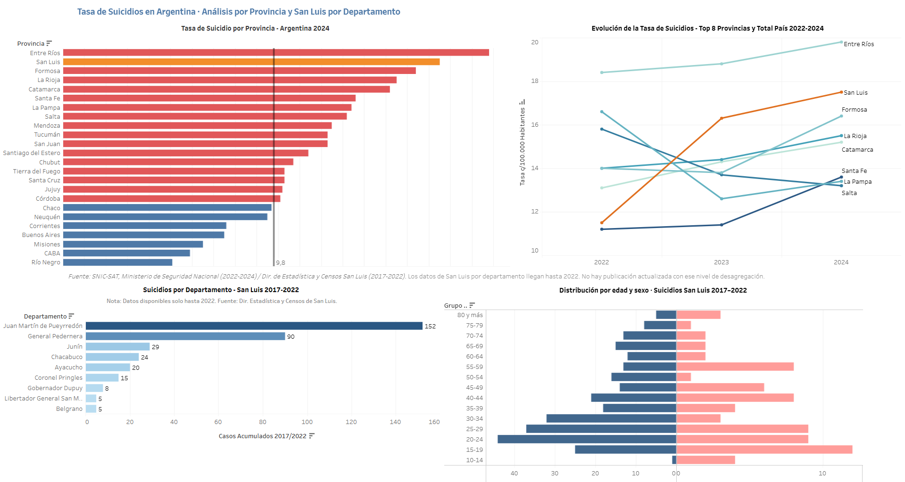

<div align="center">

# Tasa de Suicidios · Argentina (2017–2024) y San Luis (2017–2022)

**Diagnóstico cuantitativo de una problemática de salud pública, con foco en las limitaciones de los datos disponibles**

[](https://public.tableau.com/app/profile/mayco.luciano.correa/viz/TasadeSuicidios-AnlisisArgentinaySanLuispordepartamentos/Presentacin)
[](https://maycolc.github.io)


</div>

> [!NOTE]
> **Si vos o alguien cercano está pasando por un momento difícil**, podés llamar a la Línea nacional para urgencias en Salud Mental, **0800 999 0091** (gratuita), o acercarte al centro de salud más cercano. Hablar del suicidio no aumenta el riesgo: se puede prevenir.
> Fuente: [Ministerio de Salud de la Nación](https://www.argentina.gob.ar/salud/mental-y-adicciones).

<div align="center">

<a href="https://public.tableau.com/app/profile/mayco.luciano.correa/viz/TasadeSuicidios-AnlisisArgentinaySanLuispordepartamentos/Presentacin">
  
</a>

<sub>Hacé clic en la imagen para abrir el dashboard interactivo.</sub>

</div>

---

## Índice

- [Objetivo](#objetivo)
- [Hallazgos principales](#hallazgos-principales)
- [Limitaciones de los datos](#limitaciones-de-los-datos)
- [Datos utilizados](#datos-utilizados)
- [Metodología](#metodología)
- [Visualizaciones](#visualizaciones)
- [Cómo ejecutarlo](#cómo-ejecutarlo)
- [Estructura del repositorio](#estructura-del-repositorio)

---

## Objetivo

Aportar un **diagnóstico cuantitativo riguroso** sobre la tasa de suicidios en Argentina, en dos escalas:

- **Nacional (2017–2024):** evolución de la tasa en las 24 jurisdicciones (23 provincias y CABA).
- **Provincial (2017–2022):** San Luis, con la distribución de casos por departamento, grupo de edad y sexo.

Al mismo tiempo, el proyecto **documenta las limitaciones** en la disponibilidad de información pública desagregada, porque condicionan qué conclusiones se pueden sacar.

**Preguntas que responde:**

- ¿Qué jurisdicciones tienen las tasas más altas en 2024 y cómo evolucionó el promedio nacional desde 2017?
- ¿En qué año se registró el mayor aumento interanual a nivel país?
- ¿Cómo se distribuyen los casos dentro de San Luis por departamento?
- ¿Qué diferencias hay por sexo y qué grupos de edad concentran más casos en la provincia?

**Definiciones**

| Concepto | Definición |
|---|---|
| **Tasa de suicidios** | Casos cada 100.000 habitantes. Permite comparar jurisdicciones de distinto tamaño. |
| **Discrepancia de fuentes** | Conviven los registros de intervenciones policiales (SNIC) y los certificados de defunción (DEIS), con diferencias de hasta un 27 %. Se usa el SNIC-SAT por ser la única fuente nacional actualizada hasta 2024. |

---

## Hallazgos principales

| Hallazgo | Detalle |
|---|---|
| **Comparación nacional 2024** | San Luis registró una tasa de **17,5 cada 100.000 habitantes**, la segunda más alta del país y muy por encima del promedio nacional (**9,8**). |
| **Distribución dentro de San Luis** | La mayoría de los casos de 2017–2022 se concentra en **Juan Martín de Pueyrredón** y **General Pedernera**, los departamentos más poblados. Por eso se trata de casos absolutos, no de tasas departamentales. |
| **Sexo y edad** | La distribución provincial muestra una prevalencia marcadamente mayor en varones y una concentración de casos en determinadas franjas de edad. |

---

## Limitaciones de los datos

Esta sección es parte central del análisis:

- **Sin datos departamentales desde 2023** en San Luis: la serie provincial termina en 2022.
- **Anomalía en los registros de 2025** por cambios metodológicos en los sistemas de carga de la provincia de Buenos Aires. Por eso el estudio se limita a series estrictamente comparables.
- **Dos fuentes que no coinciden** (SNIC y DEIS), con diferencias de hasta un 27 %.
- **Transcripción manual** de la tabla nacional desde un PDF oficial, ya que el informe no se publica en formato de datos abiertos.
- Las vistas nacional y provincial **no se cruzan**: tienen distinto nivel de agregación y distinto período.

---

## Datos utilizados

| | Fuente nacional | Fuente provincial |
|---|---|---|
| **Organismo** | SNIC-SAT · Ministerio de Seguridad de la Nación | Dirección Provincial de Estadística y Censos de San Luis |
| **Ubicación** | cloud-snic.minseg.gob.ar → Informes → SAT → SAT_SS | estadistica.sanluis.gov.ar → Sociedad → Salud |
| **Archivo** | `Informe_Suicidios_2024.pdf` (Tabla 4) | Suicidios consumados San Luis y total país, 2017–2022 |
| **Formato** | PDF, transcripto a CSV | Excel (.xlsx) |
| **Frecuencia** | Anual | Anual |
| **Variable clave** | Tasa cada 100.000 hab. por jurisdicción | Casos absolutos por departamento, sexo y edad |
| **Cobertura** | 24 jurisdicciones, 2017–2024 | 9 departamentos, 2017–2022 |

---

## Metodología

### Etapa 1 · Python (pandas + Matplotlib)

- **Construcción y limpieza:** dataset nacional a partir del PDF oficial; limpieza del Excel provincial con `pandas`, unificando nombres y formatos. Uso de `melt` para pasar de formato ancho a largo.
- **Métricas:** variaciones absolutas y relativas interanuales. Clasificación de jurisdicciones según su distancia al promedio nacional (9,8).
- **Visualización:** `matplotlib` con colores condicionales (San Luis destacado y el resto según su posición frente al promedio) y leyendas con `mpatches`.

### Etapa 2 · Tableau

Dashboard construido con **fuentes aisladas**: los CSV nacionales y provinciales se conectan por separado para no mezclar bases con distinta agregación temporal. Diseño en mosaico con contenedores y notas visibles sobre las limitaciones estadísticas.

👉 **[Abrir el dashboard en Tableau Public](https://public.tableau.com/app/profile/mayco.luciano.correa/viz/TasadeSuicidios-AnlisisArgentinaySanLuispordepartamentos/Presentacin)**

---

## Visualizaciones

| Gráfico | Tipo | Pregunta que responde | Script |
|---|---|---|---|
| Ranking 2024 | Barras horizontales con línea de referencia | ¿Qué jurisdicciones tienen mayor tasa? | `05_g1_visualizaciones.py` |
| Evolución de las 8 jurisdicciones con mayor tasa | Líneas múltiples | ¿Cómo evolucionó la tasa en el tiempo? | `05_g2_visualizaciones.py` |
| Casos por departamento (San Luis) | Barras horizontales | ¿Dónde se concentran los casos absolutos? | `05_g3_visualizaciones.py` |
| Edad y sexo (San Luis) | Pirámide | ¿Qué grupos de edad se ven más afectados? | `05_g4_visualizaciones.py` |
| Franja horaria (San Luis) | Barras | ¿Cómo se distribuyen los casos según el horario? | `05_g5_visualizaciones.py` |
| Lugar del hecho (San Luis) | Barras | ¿Cómo se distribuyen los casos según el lugar? | `05_g6_visualizaciones.py` |

Los gráficos se generan con los scripts de Python y se guardan en `04_outputs/`, o pueden verse en el dashboard de Tableau.

---

## Cómo ejecutarlo

Requisitos: **Python 3.10+**.

```bash
# 1. Clonar el repositorio
git clone https://github.com/MaycoLC/TasaSuicidios_SanLuis.git
cd TasaSuicidios_SanLuis

# 2. Crear y activar un entorno virtual
python -m venv venv
# Windows:      venv\Scripts\activate
# Linux/macOS:  source venv/bin/activate

# 3. Instalar dependencias
pip install -r requirements.txt

# 4. Ejecutar los scripts en orden
python 02_notebooks/01_construir_dataset_nacional.py
python 02_notebooks/02_limpiar_san_luis.py
python 02_notebooks/03_analisis_nacional.py
python 02_notebooks/04_analisis_sl.py
python 02_notebooks/05_g1_visualizaciones.py   # y luego g2 a g6
```

---

## Estructura del repositorio

```
TasaSuicidios_SanLuis/
├── 01_datos/
│   ├── original/        ← Informe_Suicidios_2024.pdf (SNIC) · suicidios_san_luis_2017_2022.xlsx (Dir. Estadística SL)
│   └── procesados/      ← tasas nacionales y tablas de San Luis por departamento, edad y sexo, horario, lugar y mes
├── 02_notebooks/        ← construcción (01), limpieza (02), análisis (03, 04) y gráficos (05_g1 a 05_g6)
├── 03_capturas/         ← capturas del proceso y del dashboard
├── 04_outputs/          ← gráficos finales en PNG
├── requirements.txt
└── README.md
```

---

<div align="center">

**Mayco Luciano Correa** · Estudiante de Ciencias de la Computación (UNSL)

[Portafolio](https://maycolc.github.io) · [LinkedIn](https://www.linkedin.com/in/maycolc/) · [Tableau Public](https://public.tableau.com/app/profile/mayco.luciano.correa/vizzes) · [GitHub](https://github.com/MaycoLC)

</div>
